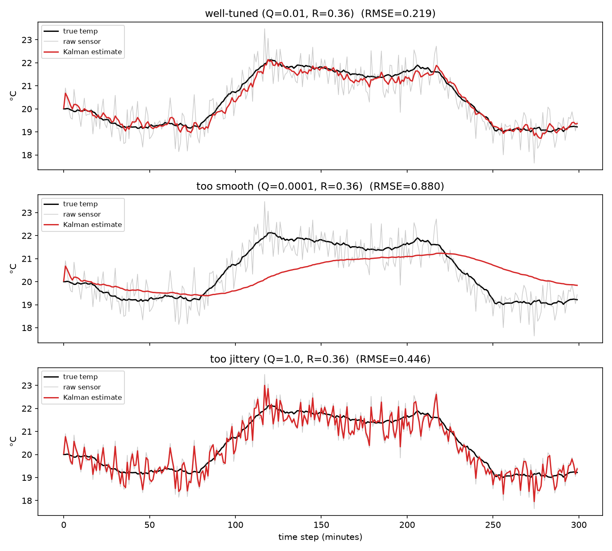

# Part 1: The Kalman Filter, via a Thermostat

This is a from-scratch walkthrough of the 1D (scalar) Kalman filter, using a
toy problem: estimating a room's true temperature from a noisy thermostat
sensor. The code referenced here lives alongside this file:

- `kalman_1d.py` — the filter itself (~25 lines)
- `thermostat_demo.py` — simulates a room, runs the filter under three
  tunings, prints RMSE, and saves `thermostat_demo.png`
- `tune.py` — grid-searches the process-noise parameter against ground truth

Run them with `source .venv/bin/activate && python thermostat_demo.py`.

## 1. The problem

You have a thermostat that reports the room temperature once a minute. The
reading jitters around — ±0.5°C or so — even when the room isn't actually
changing temperature, because the sensor itself is noisy. Meanwhile the
*actual* room temperature does change, just slowly: a heater kicks on, a
window opens, the sun moves.

You want a single number per minute — "best estimate of the true
temperature right now" — that's smoother than the raw sensor but still
tracks real changes without too much lag. That's exactly what a Kalman
filter is for: optimally combining a noisy measurement with a model of how
the thing you're measuring tends to behave.

## 2. Framing it as a state-space model

Two ingredients:

**State equation** — how the true temperature evolves over time, absent
measurements:

```
x_k = x_{k-1} + w_k,      w_k ~ N(0, Q)
```

This says: "my best guess for the temperature right now is whatever it was
last minute, plus some random drift." This is a *random walk* model — the
simplest possible model of a slowly-changing quantity. `Q` is the variance
of that drift: how much the true temperature can wander between
measurements, in °C².

**Measurement equation** — how the sensor relates to the true temperature:

```
z_k = x_k + v_k,      v_k ~ N(0, R)
```

The sensor reads the true value plus Gaussian noise with variance `R`
(°C²). `R` is a property of the sensor — you could get it from its spec
sheet or by measuring its noise in a controlled setting.

Everything the filter does is a consequence of these two equations plus the
assumption that the noise is Gaussian and zero-mean.

## 3. The filter: predict, then update

The Kalman filter keeps track of two numbers at every step:

- `x` — the current best estimate of the temperature
- `p` — the variance (uncertainty) of that estimate

Each new measurement triggers two phases:

**Predict** — project the estimate forward using the state equation, before
looking at the new measurement:

```
x_pred = x            # random walk: best guess doesn't change
p_pred = p + Q         # but uncertainty grows, because the state can drift
```

**Update** — fold in the new measurement `z`:

```
K      = p_pred / (p_pred + R)          # Kalman gain
x      = x_pred + K * (z - x_pred)      # move estimate toward measurement
p      = (1 - K) * p_pred               # uncertainty shrinks
```

`z - x_pred` is called the **innovation** — the surprise, how far off the
prediction was. `K`, the Kalman gain, is a number between 0 and 1 that says
how much of that surprise to absorb into the estimate.

That's the entire filter. No matrices needed in 1D — see `kalman_1d.py` for
the direct implementation of these five lines.

### Why the gain formula makes sense

`K = p_pred / (p_pred + R)`. Look at the limits:

- If `R` is huge (sensor is garbage) relative to `p_pred`, `K → 0`: ignore
  the measurement, trust the prediction.
- If `p_pred` is huge (we're very unsure of our prediction) relative to
  `R`, `K → 1`: ignore the prediction, trust the measurement.

The gain is literally "the fraction of my total uncertainty that's coming
from the prediction side." It's a precision-weighted average of prediction
and measurement — nothing more exotic than that.

## 4. What Q and R actually control

Run `thermostat_demo.py`. It simulates 300 minutes of a room that drifts
slowly, has a heater turn on for a stretch, and later a window open, with a
sensor noise of σ=0.6°C (`R = 0.36`). It runs the filter three times with
different `Q`:

| tuning | Q | R | steady-state K | RMSE |
|---|---|---|---|---|
| well-tuned | 0.01 | 0.36 | 0.153 | 0.230 |
| too smooth | 0.0001 | 0.36 | 0.017 | 0.880 |
| too jittery | 1.0 | 0.36 | 0.781 | 0.446 |
| *(raw sensor, unfiltered)* | — | — | — | 0.557 |



Three takeaways, all visible in the plot:

- **Low Q (top-heavy trust in the model)** → low gain → heavy smoothing,
  but the filter *lags* behind real changes. In the "too smooth" row,
  during the heater ramp (minutes 80–120) the red line is still climbing
  well after the true temperature has leveled off — it's not keeping up
  because the filter doesn't believe the state is allowed to move fast.
  Its RMSE (0.880) is actually *worse* than just using the raw sensor
  (0.557): the lag error outweighs the noise it removed.

- **High Q (low trust in the model, i.e. "the state can jump around a
  lot")** → high gain → the filter tracks real changes fast, but it also
  tracks sensor noise fast. The "too jittery" row barely looks smoothed at
  all compared to the raw gray trace.

- **Q and R in the right ratio** → the filter smooths out sensor noise
  during flat stretches *and* tracks the ramps reasonably quickly. This is
  the sweet spot, and it's not a single "right" value — it's a trade-off
  curve.

### It's the ratio, not the absolute values, that matters

Multiply both `Q` and `R` by the same constant and the Kalman gain `K` is
unchanged — only the ratio `Q/R` determines the filter's steady-state
behavior (the absolute values only affect how fast the filter converges
from its initial uncertainty `p`). This is why Kalman-filter tuning is
usually described as "how much do I trust the model vs. the sensor,"
not in terms of either parameter alone.

### Steady state

If `Q` and `R` are constant, `p` converges to a fixed point (you can see
this as the gain settling down after the first several steps — it's what
the demo prints as "steady-state K"). For the scalar random-walk case, the
steady-state *predicted* variance `P` solves `P² = Q·P + Q·R`, giving:

```
P    = ( Q + sqrt(Q² + 4*Q*R) ) / 2
K_ss = P / (P + R)
```

Plugging in the well-tuned demo's `Q=0.01, R=0.36` gives `P ≈ 0.0652` and
`K_ss ≈ 0.1534` — exactly what the demo prints. After the initial
transient (driven by the starting `p=1.0`), the filter settles into
applying this constant blend of prediction and measurement.

## 5. Tuning: how do you actually pick Q and R?

**R is usually the easier one.** It's a property of your sensor. Point it
at something at a known-constant temperature, record readings, and take the
sample variance. That's `R`.

**Q is harder** because it's a property of the *process*, not the sensor,
and "how much does the real temperature actually wander minute to minute"
isn't something you can read off a spec sheet. A few approaches, roughly in
order of how much you can afford:

1. **Physical reasoning + eyeballing.** Start from what you know about the
   process (a room's temperature doesn't change by 5°C in one minute under
   normal conditions) and simulate/plot a few candidate `Q`s, as the demo
   does. Pick the one that looks like it tracks real changes without
   visibly chasing noise.

2. **Grid search against ground truth**, if you have it (e.g. in
   simulation, or you have a more accurate reference sensor during a
   calibration run). `tune.py` does exactly this: it sweeps `Q` from 1e-5
   to 10 and computes RMSE against the known true temperature. Run it and
   you'll see a clean U-shaped curve — too-low Q underfits (lags), too-high
   Q overfits (noisy), and there's a minimum in between. In this demo the
   grid search finds the minimum around `Q ≈ 0.018`, close to the `0.01`
   used in the main demo.

3. **Innovation statistics**, when you *don't* have ground truth (the
   normal real-world case). The innovation `z - x_pred` should, if the
   filter is well-tuned, look like zero-mean Gaussian noise with variance
   `p_pred + R` — no residual structure, no autocorrelation. In practice:
   log the innovations over a run, and check:
   - Their variance should roughly match `p_pred + R` as predicted — if
     actual innovation variance is consistently larger than predicted, the
     filter is overconfident (Q or R too low somewhere); if smaller, it's
     underconfident.
   - They shouldn't be autocorrelated. If innovations are positively
     autocorrelated (a positive surprise tends to be followed by another
     positive surprise), the filter is under-reacting — Q is too low and
     real changes are leaking through as a run of same-signed "noise."
   This is the standard tool when you only have live sensor data to tune
   against (it generalizes to the Normalized Innovation Squared / NIS
   statistic, with a chi-squared consistency test, in the multivariate
   case).

4. **Maximum likelihood / optimization.** Treat `(Q, R)` as parameters and
   maximize the likelihood of the observed measurement sequence under the
   filter (the innovations' Gaussian likelihood, summed over time steps).
   This is just #2 generalized to not need ground truth — you numerically
   optimize over `Q`, `R` to maximize that likelihood instead of minimizing
   RMSE against a truth you don't have. Works well when you have a decent
   amount of representative logged data.

In practice: start with #1 to get in the right ballpark, confirm with #2 if
you ever get a chance to validate against ground truth, and use #3 as your
ongoing sanity check once deployed.

## 6. Where to go from here

This scalar case hides the two things that make the "real" Kalman filter
look intimidating:

- **Multiple state variables.** E.g. track temperature *and* its rate of
  change (is it currently rising or falling), so the model can predict
  "the room is warming at 0.1°C/min" instead of just "last known value."
  This turns `x`, `p`, `Q`, `R` into vectors/matrices, and the predict/
  update equations become matrix versions of exactly the same five lines
  above — no new ideas, just more bookkeeping. **See
  `tutorial_2_constant_velocity.md`** — it builds exactly this on top of
  the code here, and directly fixes the lag visible in the "too smooth"
  row above.
- **Nonlinear relationships** between state and measurement (e.g. a GPS
  giving you lat/long but you care about a nonlinear combination of
  states). That's what the Extended Kalman Filter (EKF) and Unscented
  Kalman Filter (UKF) are for — linearize or sample around the nonlinearity,
  then apply the same predict/update logic.

Everything else (sensor fusion with multiple independent measurements,
smoothing using future data, etc.) builds on this same predict/update
skeleton.
