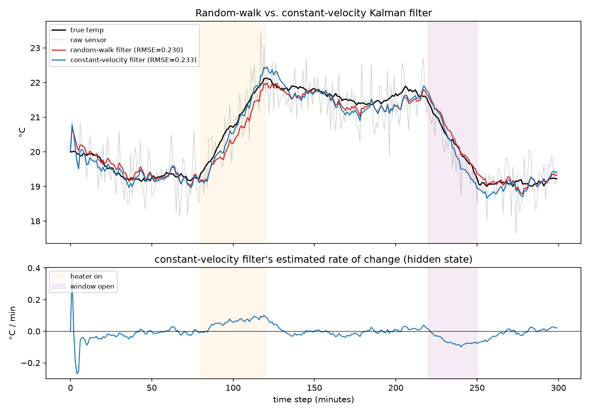

# Part 2: Adding a Hidden State — Position + Velocity

Part 1 (`tutorial.md`) built a scalar Kalman filter that models the room
temperature as a random walk: "my best guess for next minute is this
minute's value." That model has a structural weakness, visible in the
plots from part 1 — during the heater ramp, the filter's estimate visibly
*lags* the true temperature, because the model has no concept of "currently
rising." It only ever reacts, one step late, to a trend that's already
underway.

This part fixes that by adding a second state variable: the *rate of
change*. The code is in `kalman_nd.py` (a general matrix Kalman filter) and
`thermostat_cv_demo.py` (the comparison demo). Run it:

```
source .venv/bin/activate
python thermostat_cv_demo.py
```

## 1. The constant-velocity model

Instead of a single number `x` (temperature), the state is now a vector:

```
x = [ temp, rate ]
```

State equation — "assume the current trend continues":

```
temp_k = temp_{k-1} + rate_{k-1} * dt
rate_k = rate_{k-1}
```

In matrix form, `x_k = F x_{k-1} + w_k` with:

```
F = [ 1   dt ]
    [ 0    1 ]
```

This is called a **constant-velocity (CV) model**: it assumes velocity
(rate of change) is constant between steps, except for random drift. It's
exactly analogous to the scalar random-walk model, just one derivative up —
you could keep going and add acceleration as a third state (a
"constant-acceleration" model) if you needed to track something that
speeds up and slows down more sharply.

Measurement equation — the sensor still only measures temperature, not
rate directly:

```
z_k = H x_k + v_k,    H = [ 1  0 ]
```

`H` picks out the first element of the state vector. This is the key idea
generalized from part 1: **the filter can estimate states you never
directly measure.** You only ever observe temperature, but the filter
maintains — and continuously refines — an estimate of the room's current
warming/cooling rate as a byproduct of fitting the model to measurements.
That's the `rate` subplot in `thermostat_cv_demo.png`: it's not something
we measured, it's something the filter *inferred*.

## 2. Predict/update, same shape as before

The equations from part 1 generalize directly — scalars become vectors,
multiplication becomes matrix multiplication, division becomes matrix
inverse:

```
# predict
x_pred = F @ x
P_pred = F @ P @ F.T + Q

# update
y = z - H @ x_pred                        # innovation (still a scalar here: 1 sensor)
S = H @ P_pred @ H.T + R                   # innovation covariance
K = P_pred @ H.T @ inv(S)                  # Kalman gain (now a vector: how much
                                            #   each state moves per unit of surprise)
x = x_pred + K @ y
P = (I - K @ H) @ P_pred
```

This is exactly `kalman_nd.KalmanFilter` — compare it line-by-line with
`kalman_1d.KalmanFilter1D` from part 1. No new ideas, just matrices instead
of numbers. `K` is no longer a single trust-weight; it's a vector saying
how much *each* state (temp and rate) should move in response to a given
surprise in the measurement. A rising stretch of measurements doesn't just
nudge the temperature estimate up — it also nudges the velocity estimate
up, because that's the state that makes this and future predictions better
fit what's being observed.

## 3. Q for a 2-state model isn't just "a number"

In part 1, `Q` was a single scalar: how much the temperature itself could
randomly drift per step. Here, the *physical* source of randomness is
usually more naturally thought of as random **acceleration** — an
unpredictable push that perturbs the rate, which then perturbs the
position. The standard discretization (the "discrete white noise
acceleration" model) turns a single scalar `q` (the power of that random
acceleration) into a full covariance matrix:

```
Q = q * [ dt⁴/4   dt³/2 ]
        [ dt³/2    dt²  ]
```

This isn't arbitrary — it falls out of integrating random acceleration
over one time step twice (once for velocity, once for position), so the
noise on position and velocity ends up correlated in the specific way a
physically-accelerating process would be. You still only have one knob to
tune (`q`), same as before, but it now shapes a 2x2 matrix instead of a
single variance.

## 4. Does it actually help?

Comparing the constant-velocity filter against part 1's well-tuned
random-walk filter, on the identical simulated data:

| filter | RMSE | lag crossing 21.0°C during the heater ramp |
|---|---|---|
| raw sensor | 0.557 | — |
| random-walk (part 1) | 0.230 | 7 steps |
| constant-velocity | 0.233 | 1 step |



Overall RMSE is essentially tied (0.230 vs 0.233 — the CV filter isn't
"better" in aggregate here, because most of the 300 steps are flat, where
there's no trend to exploit). But look at the **lag**: the random-walk
filter takes 7 extra steps after the true temperature to register the same
value, because it has no way to anticipate a trend — it only follows,
reactively, one noisy measurement at a time. The constant-velocity filter
crosses the same threshold just 1 step after the true temperature, because
once it infers a positive rate (bottom panel), it projects that rate
forward in its predictions instead of assuming the state is static.

This is the general trade-off of adding states to a Kalman filter: more
states let the model represent richer behavior (trends, not just levels),
which reduces lag on exactly the kind of transient a lower-order model
structurally can't anticipate — at the cost of more parameters to tune and
more noise-sensitivity if `q` is too high (the velocity state itself is
only inferred from noisy data, so an under-tuned CV filter can overreact
to a run of noisy measurements by inventing a trend that isn't there — try
setting `q = 0.01` in `thermostat_cv_demo.py` and compare).

### Tuning `q`

`tune_cv.py` does the same grid search as part 1's `tune.py`, sweeping `q`
and checking RMSE against the simulated ground truth. It finds a minimum
around `q ≈ 0.0001` (used above) — again a clean U-shape: too small and the
velocity state barely updates (collapsing back toward the lagged
random-walk behavior), too large and the velocity state chases sensor
noise, which then leaks into the position estimate via `F`.

### Also notice: the start-up transient

Look at the very start of the `rate` subplot — the filter's velocity
estimate spikes to about +0.25 and then swings to -0.25 within the first
few steps before settling down. That's not something to fix; it's the
velocity state, initialized at a guess of 0 with high uncertainty,
reacting strongly to the very first noisy measurements before `P` has
shrunk. It's the same "prior → chasing the first few measurements" behavior
every Kalman filter has at `k=0`, just more visible here because velocity
starts from a completely uninformed guess.

## 5. What's still missing

This is still a **linear** model — the state transition and measurement
equations are both just matrix multiplications. That's true for plenty of
real systems (this one included), but not all of them: if the relationship
between state and measurement is nonlinear (a classic example: a radar
giving you range and bearing, which you want to turn into x/y position),
you need the Extended Kalman Filter (linearize around the current estimate
at each step, via a Jacobian) or the Unscented Kalman Filter (propagate a
small set of sample points through the true nonlinear function instead of
linearizing). Both still boil down to the same predict/update skeleton —
they just change how `F` and `H` (or their effect) get computed at each
step. **See `tutorial_3_unscented.md`** — it builds exactly this on top of
the radar range/bearing example above.
