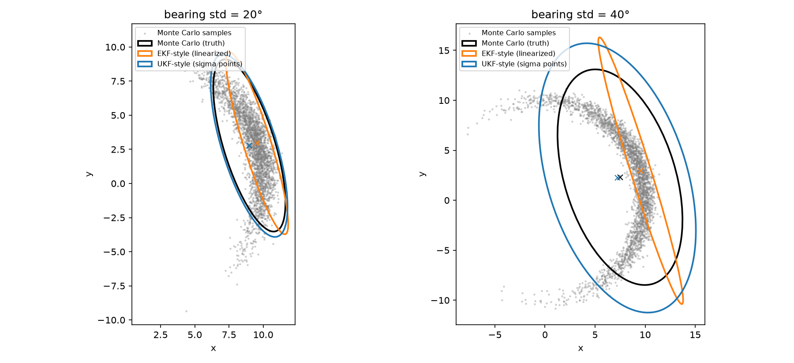
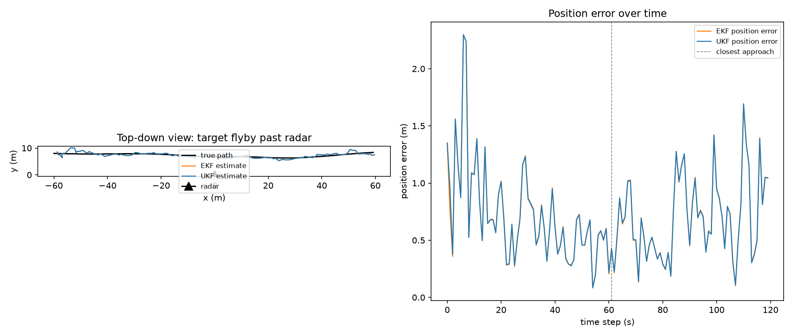

# Part 3: Nonlinear Measurements — the Unscented Kalman Filter

Parts 1 and 2 built filters where everything — the state transition `F`
and the measurement `H` — was a fixed matrix. That's the *linear* Kalman
filter, and it's exact only when those relationships really are linear.
Plenty of real sensors aren't: a radar gives you range and bearing, not
x/y position; a GPS pseudorange is a nonlinear function of your 3D
position; a camera projection is nonlinear in depth. This part is about
what to do when the measurement function `h(x)` (or the state transition
`f(x)`) is nonlinear.

The code:

- `kalman_ukf.py` — a general Unscented Kalman Filter (UKF), for any `f`/`h`
- `kalman_ekf.py` — a general Extended Kalman Filter (EKF), for comparison
- `polar_transform_demo.py` — isolates *why* the UKF works, with no filter
  loop involved: converts one noisy polar measurement to Cartesian and
  compares against Monte Carlo ground truth
- `radar_demo.py` — a full tracking filter (EKF vs. UKF) on a simulated
  radar flyby

Run them with `source .venv/bin/activate && python polar_transform_demo.py`
(then `python radar_demo.py`).

## 1. Why linear algebra stops being enough

Say a radar at the origin measures a target's range `r` and bearing
`theta`, but you want to track its position in Cartesian coordinates
`(x, y)`:

```
x = r * cos(theta)
y = r * sin(theta)
```

There is no matrix `H` such that `[x, y] = H @ [r, theta]` — `cos` and
`sin` aren't linear functions. So you can't even write down part 2's
filter for this problem; `H @ P @ H.T` doesn't mean anything if there's no
`H`. You need a different strategy for the update step whenever the thing
you measure isn't a linear function of the thing you're estimating.

Two standard fixes, both still built on the same predict/update skeleton
from parts 1–2:

- **Extended Kalman Filter (EKF):** linearize `h` (and `f`, if that's
  nonlinear too) at the current estimate, using its Jacobian, then run the
  ordinary linear filter with that one-step-local linear approximation in
  place of `H`. Cheap, and the obvious generalization — but a derivative
  at a single point is only a good stand-in for the whole function near
  that point.

  **Notation warning:** parts 1–2's `H` and this `H` are not the same kind
  of object, even though the EKF literature (and `kalman_ekf.py`'s `Hjac`)
  reuses the letter. Parts 1–2's `H` was one fixed matrix for the entire
  filter run, and `z = H @ x` held exactly. Here, `H` is `∂h/∂x`
  *re-evaluated at the current estimate every step* — a snapshot of a
  derivative that's only locally and momentarily accurate, not an exact,
  unchanging relationship. It's reused because it slots into the same
  update equations (`K = P H^T (H P H^T + R)^-1`, etc.), not because it's
  the same kind of thing.
- **Unscented Kalman Filter (UKF):** don't linearize at all. Pick a small,
  deterministic set of sample points around the current estimate — "sigma
  points" — chosen so their weighted mean and covariance exactly match
  the current Gaussian. Push each one through the *real*, nonlinear `f`
  or `h`. Reconstruct a Gaussian from the transformed points' weighted
  mean and covariance. This is the **unscented transform**.

## 2. The unscented transform, concretely

For an `n`-dimensional Gaussian with mean `x` and covariance `P`, the UKF
uses `2n + 1` sigma points: the mean itself, plus `n` pairs straddling it
along the "square root" of the (scaled) covariance:

```
lambda = alpha^2 * (n + kappa) - n
S      = cholesky( (n + lambda) * P )     # S @ S.T = (n+lambda) P

X_0     = x
X_i     = x + S[:, i]        for i = 1..n
X_{n+i} = x - S[:, i]        for i = 1..n
```

`alpha` (small, e.g. 0.1) controls how far the points spread from the
mean; `kappa` is a secondary scaling knob (0 is a common default); `beta`
(2 is optimal for Gaussian inputs) folds in extra weight on the center
point when reconstructing the covariance. These three replace `Q` and `R`
as the UKF's "extra" tuning knobs — in practice you rarely need to touch
them.

Each sigma point carries a weight — `Wm` for reconstructing the mean,
`Wc` for the covariance (they differ only at the center point):

```
Wm[0] = lambda / (n + lambda)                    Wc[0] = Wm[0] + (1 - alpha^2 + beta)
Wm[i] = Wc[i] = 1 / (2*(n + lambda))    for i > 0
```

**Predict:** push every sigma point through `f`, recombine:

```
X'_i   = f(X_i)                     for each sigma point
x_pred = sum_i Wm[i] * X'_i
P_pred = sum_i Wc[i] * (X'_i - x_pred)(X'_i - x_pred)^T  +  Q
```

**Update:** same idea, through `h`, plus the usual cross-covariance for
the gain:

```
Z_i  = h(X_i)                                   for sigma points drawn from (x_pred, P_pred)
zhat = sum_i Wm[i] * Z_i
Pzz  = sum_i Wc[i] * (Z_i - zhat)(Z_i - zhat)^T  +  R
Pxz  = sum_i Wc[i] * (X_i - x_pred)(Z_i - zhat)^T

K = Pxz @ inv(Pzz)
x = x_pred + K @ (z - zhat)
P = P_pred - K @ Pzz @ K.T
```

Compare this with part 2's five-line linear update — it's the same shape
(innovation, innovation covariance, gain, correct mean, shrink
covariance), just with the sigma-point recipe standing in for `H @ P @
H.T` wherever the linear filter used matrix multiplication. **If `f`/`h`
really are linear, the unscented transform reproduces the linear Kalman
filter exactly** — it's a strict generalization, not a different answer
for the linear case. See `kalman_ukf.py` for the direct implementation.

## 3. Does sampling actually beat linearizing?

`polar_transform_demo.py` isolates the comparison, with no filter loop to
obscure it: take one measurement `r=10, theta=0.3` with `sigma_r=0.5` and
a *varying* bearing uncertainty, convert it to `(x, y)` three ways — (a)
Monte Carlo: draw 200,000 samples from the input Gaussian, transform each
through the real `cos`/`sin`, and look at the empirical mean/covariance,
as ground truth; (b) EKF-style: linearize at the measurement via the
Jacobian; (c) UKF-style: the unscented transform above.

```
bearing std   mean err (EKF)   mean err (UKF)   cov err (EKF)   cov err (UKF)
         2°          0.0060          0.0001         0.0009         0.0009
        10°          0.1486          0.0038         0.0987         0.0910
        20°          0.5875          0.0216         1.5353         1.3949
        30°          1.2817          0.0886         6.8958         6.3065
        45°          2.6530          0.4283        28.1867        27.2806
```



At small uncertainty (2°) both methods agree with the truth — locally,
`cos`/`sin` really do look linear. As bearing uncertainty grows, the
**EKF's mean estimate** (a single point, pushed through `h` with no
curvature correction) drifts away from the true mean 5–6x faster than the
UKF's — because the true distribution bends into the "banana" shape
visible in the plot, and a fixed derivative at one point has no way to
know the function curves. The UKF's sigma points, spread across the same
region the real distribution occupies, average out that curvature instead
of ignoring it. Both methods' *covariance* estimates degrade together at
high uncertainty (neither is reconstructing a true Gaussian from a
fundamentally non-Gaussian banana — that's a harder problem, solved by
particle filters, not covered here) — but the UKF's mean stays
dramatically more accurate throughout, exactly because it never
linearizes.

## 4. Putting it in a filter: tracking a radar flyby

`radar_demo.py` runs the full predict/update loop — EKF and UKF side by
side — on a simulated target flying past a fixed radar, measured only in
(noisy) range and bearing:

```
state:        x = [px, vx, py, vy]      (position + velocity, both axes)
transition:   constant-velocity, same F as part 2 — linear
measurement:  r = sqrt(px^2+py^2), theta = atan2(py, px) — nonlinear
```

```
closest approach at step 61, true range 6.88 m

filter   pos RMSE (all steps)   pos RMSE (near closest approach)
EKF                     0.810                              0.563
UKF                     0.811                              0.566
```



The two filters are, for all practical purposes, identical here — the
plotted traces sit on top of each other. **This is a real and useful
result, not a wash**: it's telling you that in this scenario the
measurement noise (range σ=1m, bearing σ≈1.7°) keeps the filter's
uncertainty small enough, at every step, that `h`'s curvature over that
small region is negligible — exactly the "2° bearing std" row of the
table above, where EKF and UKF also agreed. The lesson from section 3 only
shows up once uncertainty is large *relative to the curvature of h* — a
badly-initialized filter, a low measurement rate, or a sensor with much
coarser bearing resolution would all stretch the per-step uncertainty back
out and reopen the gap. (Try it: push `bearing_noise_std` up past ~0.1
rad with a large initial `P0` in `radar_demo.py`, and the two diverge —
sometimes with the UKF doing *better*, sometimes *worse*, since far enough
into "very nonlinear," which approximation wins stops being a sure thing.)

So why reach for the UKF at all, if it often ties the EKF in practice?

- **No Jacobian required.** `kalman_ekf.py`'s `Hjac` for this radar
  example is four lines of calculus you have to get right by hand; swap in
  a more complicated `h` (a camera projection, a multi-body orbital
  model) and that derivative gets a lot less fun to derive and debug. The
  UKF only ever needs `h` itself — section 3's whole comparison used the
  exact same `cos`/`sin` for both the "truth" and the UKF side.
- **No risk of linearizing at a bad point.** The EKF's accuracy depends
  entirely on the current estimate being close enough to the truth that
  the local derivative is representative. Early in a filter's life, or
  after a bad update, that's exactly when it's least true — and the EKF
  has no way to notice. The UKF's sigma points still sample the real
  function across however wide the current uncertainty actually is.
- **Strictly more general**, at roughly the same cost (`2n+1` evaluations
  of `f`/`h` instead of one evaluation plus one Jacobian) — there's rarely
  a reason to reach for the EKF except that its code is a few lines
  shorter when the Jacobian is trivial to write down.

## 5. What's still missing

The UKF (like the EKF) still assumes the posterior is well-approximated by
a *Gaussian* — it gets the mean and covariance of a nonlinear transform
right, but if the true distribution is multimodal (e.g. the radar return
could plausibly belong to either of two targets) or heavily skewed, no
single Gaussian, however it's computed, will capture that. That's what
particle filters are for: representing the distribution with a swarm of
weighted samples instead of a mean and covariance, at the cost of needing
many more samples than this filter's `2n+1` sigma points.
